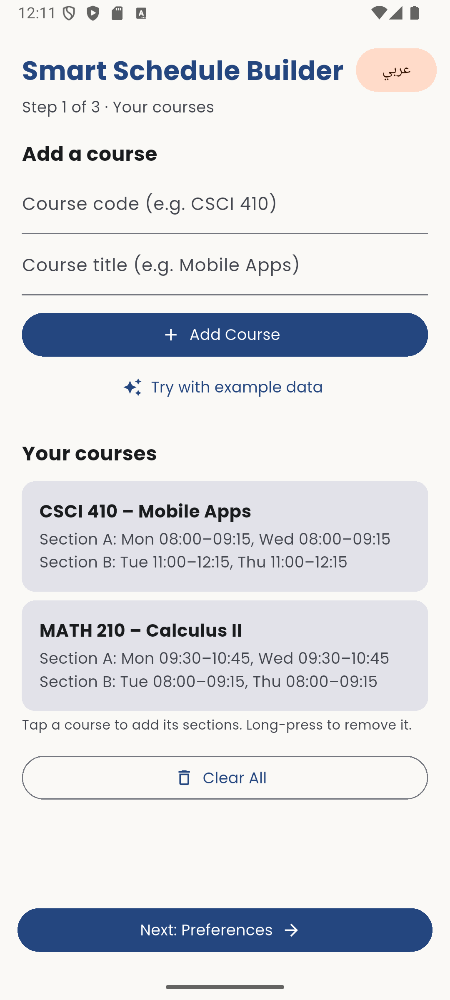
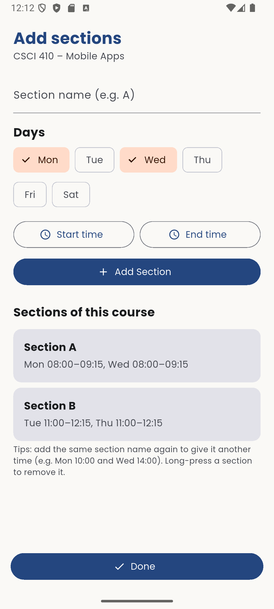
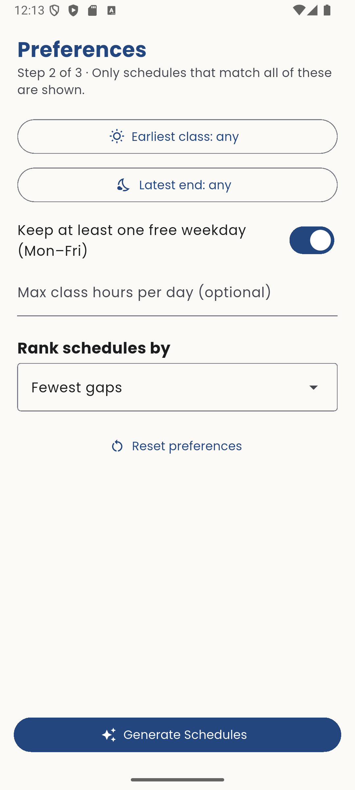
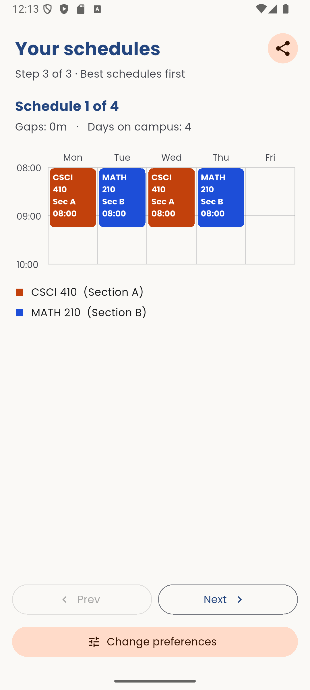
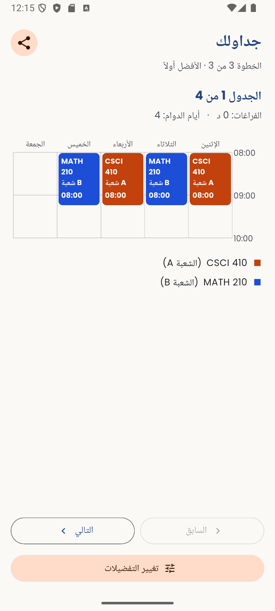

# Smart Course Schedule Builder

**CSCI 410 – Mobile Applications · Project 1**
Student: **Ahmad Chhadi** · Lebanese International University

A **Flutter** app that helps a student plan the semester. You enter your courses,
their sections, days and times. The app builds **every clash-free weekly schedule**,
filters them by your preferences, ranks them best-first and draws each one as a
colored weekly timetable that you can share as an image.

## Screenshots

| Courses | Sections | Preferences | Schedule | Arabic |
|:---:|:---:|:---:|:---:|:---:|
|  |  |  |  |  |

## Download

Install the app on any Android phone from the
[latest release](https://github.com/ahmad-chhadi/smart-schedule-builder/releases/latest)
(`SmartScheduleBuilder-v2.0.apk`).

## Features

- Add courses and sections (one section can meet on several days).
- Backtracking algorithm that finds every combination with no time clash.
- Filters: earliest class, latest end, keep a free weekday, max hours per day.
- Ranking: fewest gaps, fewest days on campus, or latest start.
- Explains *why* nothing fits (which two courses always clash).
- Weekly timetable drawn with `CustomPainter`.
- Share the schedule as a PNG image.
- English and Arabic (full right-to-left layout), light and dark theme.
- No database: all data lives in memory while the app is open.

## Pages

1. **Courses** – add / remove courses, load example data, switch language.
2. **Add sections** – section name, days, start and end time.
3. **Preferences** – filters and ranking, then *Generate*.
4. **Schedules** – timetable, legend, previous / next, share.

## Project structure

```
lib/
  main.dart                 app entry, theme, language
  models/                   TimeSlot, Section, Course
  logic/                    ScheduleGenerator, ScheduleRanker, ClashExplainer
  data/app_data.dart        in-memory data shared by the pages
  l10n/strings.dart         English + Arabic text
  ui/                       theme, shared widgets, timetable painter
  screens/                  the four pages
test/                       unit tests for the logic + a widget test
```

## Run it

```
flutter pub get
flutter run
flutter test
```

Built with Flutter 3.50 / Dart 3.14. The same code can also be built for iOS (this needs a Mac with Xcode).
