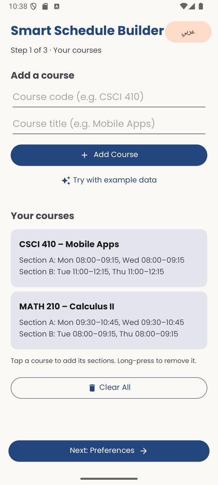
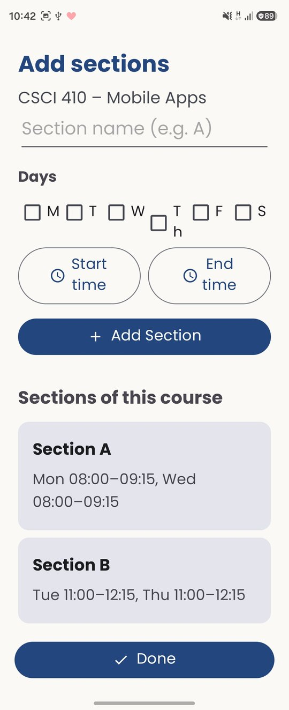
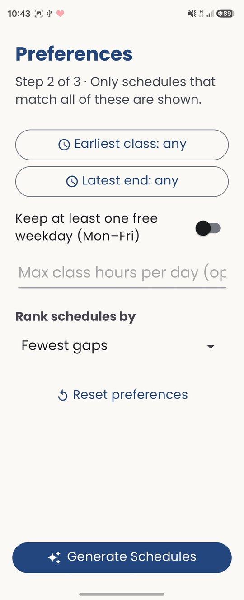
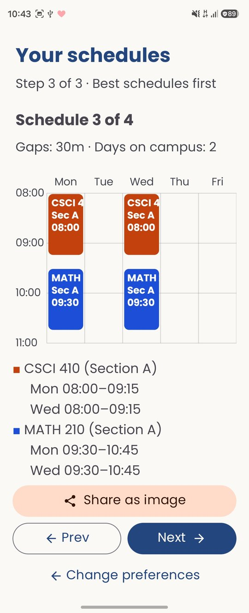
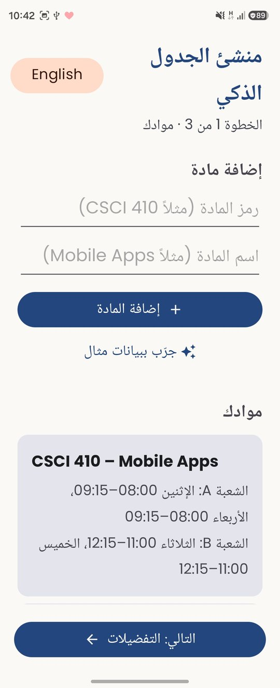

# Smart Schedule Builder

An Android app (Java) that turns a student's course sections into **every clash-free weekly timetable**, then filters and ranks them so the best schedule comes first.

CSCI 410 – Mobile Application project · Ahmad Chhadi

## The problem

During registration every course has several sections on different days and times. Students compare them by hand to avoid clashes, which is slow and often ends with 8 AM starts, long gaps and no free day.

## Features

- **Courses and sections** – add courses, then their sections with days and start/end times. A section can meet at different times on different days.
- **Clash-free generation** – finds every combination of one section per course with no time overlap.
- **Filters** – earliest class, latest end, keep a free weekday (Mon–Fri), maximum class hours per day.
- **Ranking** – fewest gaps, fewest days on campus, or latest start.
- **Weekly timetable** – each schedule is drawn as a color-coded grid by a custom `View`.
- **Clash explanation** – when nothing fits, the app names the courses that always clash.
- **Share as image** – export the timetable as a PNG through the Android share menu.
- **English and Arabic** – the app follows the phone's language; Arabic is shown right-to-left.
- **Light and dark mode** – custom navy and orange theme, Poppins font and a custom app icon.
- **No database** – data is kept in memory only while the app is open. Nothing is saved locally or online.

## Pages

| # | Activity | What it does |
|---|---|---|
| 1 | `MainActivity` | Add courses and see the course list |
| 2 | `AddSectionActivity` | Add sections, days and times to one course |
| 3 | `PrefsActivity` | Set filters and ranking, then generate |
| 4 | `SchedulesActivity` | Browse the ranked timetables, share one as an image |

## Screenshots

| Courses | Sections | Preferences | Timetable |
|---|---|---|---|
|  |  |  |  |

**Arabic** – one tap on the language button switches the whole app to Arabic (right-to-left):



## How it works

The core is a **backtracking search with pruning** (`ScheduleGenerator`):

```
generate(i, chosen):
    if i == number of courses:
        save a copy of chosen          // every course has a section
        return
    for each section s of course i:
        if s does not clash with anything in chosen:   // pruning
            chosen.add(s)
            generate(i + 1, chosen)
            chosen.removeLast()        // backtrack
```

Times are stored as minutes from midnight (10:30 → 630). Two classes clash when they are on the same day and `a.start < b.end && b.start < a.end`, so back-to-back classes (one ends at 11:15, the next starts at 11:15) do not clash.

`ScheduleRanker` then removes schedules that break a filter and sorts the rest by a score (lower is better).

## Project structure

```
app/src/main/java/com/ahmad/smartschedulebuilder/
├── MainActivity.java          Page 1: courses
├── AddSectionActivity.java    Page 2: sections, days, times
├── PrefsActivity.java         Page 3: filters, ranking, Generate
├── SchedulesActivity.java     Page 4: timetables, Prev/Next, Share
├── data/AppData.java          Data shared by the pages (in memory only)
├── model/                     TimeSlot, Section, Course
├── logic/                     ScheduleGenerator, ScheduleRanker, ClashExplainer
└── ui/                        TimetableView (custom drawing), UiUtils
```

Logic is kept separate from the pages, so it is covered by plain unit tests in `app/src/test/.../ScheduleLogicTest.java`.

## Build and run

1. Install a recent version of **Android Studio**.
2. Clone the repository:
   ```
   git clone https://github.com/ahmad-chhadi/smart-schedule-builder.git
   ```
3. Open the folder in Android Studio and wait for Gradle sync.
4. Run the `app` configuration on an emulator or a phone (Android 8.0 / API 26 or newer).

To run the unit tests, right-click `ScheduleLogicTest` and choose **Run**.

## Download

The installable APK will be attached to the [Releases](https://github.com/ahmad-chhadi/smart-schedule-builder/releases) page.

## Built with

Java · Android SDK · AppCompat and Material Components · Android Studio · Git and GitHub
